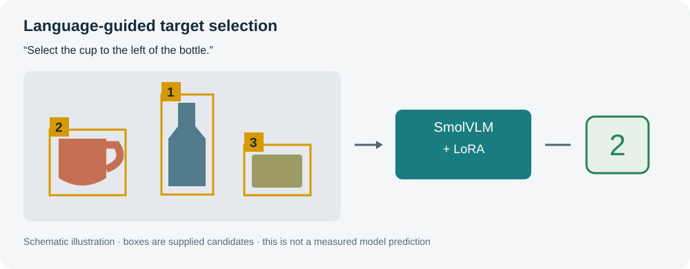
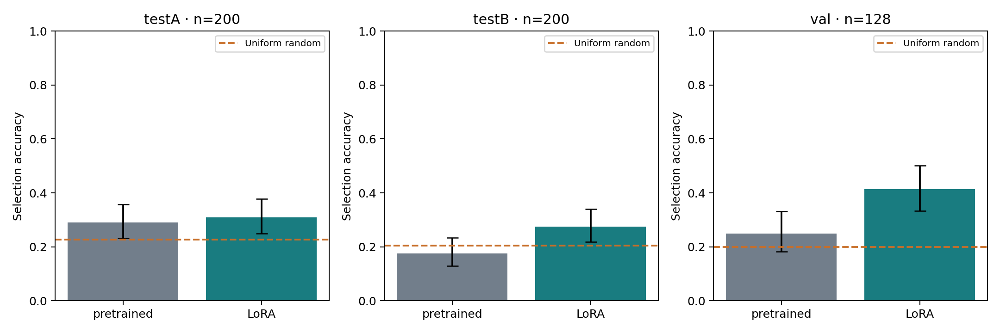
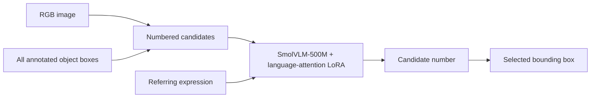

# Language-Guided Robot Target Selection

Adapt a compact vision-language model to select a referred object in a cluttered scene. The input is an RGB image with uniformly drawn, numbered candidate boxes and a natural-language instruction. The output is one candidate number, which maps back to a bounding box.



**Measured on a free Colab T4:** LoRA reaches **31.0% vs 29.0% pretrained on testA**, and **27.5% vs 17.5% on testB**, on fixed subsets of 200 images each. The paired 95% interval includes no gain on testA; testB shows a positive gain on this sample. Candidate-renumbering consistency remains weak. See [RESULTS.md](RESULTS.md) for the analysis and uncertainty, and [docs/VALIDATION.md](docs/VALIDATION.md) for execution evidence.





The experiment uses **provided candidates** from RoboRefIt annotations. It measures language-guided selection, not autonomous object detection, grasp synthesis, or robot control. Annotation IDs, object-class metadata, file paths, and the true target index are never included in the model input. Only the uniformly numbered image, instruction, and candidate count are visible.

## Reproduction

Open [Google Colab](https://colab.research.google.com/) and import [notebooks/Robot_Target_Selection.ipynb](notebooks/Robot_Target_Selection.ipynb). Select **Runtime → Change runtime type → T4 GPU**. The notebook includes its complete source bundle, so no repository clone or Python source upload is needed. All model computation runs in the remote runtime.

Set the mode in the first code cell, then choose **Run all**:

| Mode | Purpose | Training |
|---|---|---|
| `smoke` (default) | Verify download, protocol, gradients, reload, evaluation, demo and exports | 4 optimizer steps |
| `experiment` | Reproduce the fixed 2,000-image experiment and seed repeat | 250 steps per seed |
| `inference` | Load an exported adapter, evaluate a small subset and explore the demo | None |

Every mode retrieves and verifies the same 6.1 GB author archive. Smoke reduces model work, not the initial archive download. Change `RUN_TAG` to preserve earlier runs within the same runtime. Temporary Colab storage can expire; keep the exported results and adapter ZIPs. No paid API, Hugging Face token or Drive mount is required by the pipeline.

For inference, upload only the exported adapter ZIP when prompted, or supply a public archive URL and its SHA-256 in the first cell. The exact base-model revision is loaded automatically. Verified checkpoint hashes and instructions are in [docs/CHECKPOINTS.md](docs/CHECKPOINTS.md). A public release URL will be added when the repository destination is available.

The reusable package also exposes these commands from the repository root in a remote environment:

```bash
python -m pip uninstall -y torchao
python -m pip install -r requirements-colab.txt
python -m pip install --no-deps -e .
python -m robot_target.cli download --data /content
python -m robot_target.cli prepare --config configs/smoke.json --manifests artifacts/smoke-manifests
python -m robot_target.cli evaluate --config configs/smoke.json --manifests artifacts/smoke-manifests --output artifacts/smoke-baseline
python -m robot_target.cli train --config configs/smoke.json --manifests artifacts/smoke-manifests --output artifacts/smoke
python -m robot_target.cli verify-reload --config configs/smoke.json --manifests artifacts/smoke-manifests --output artifacts/smoke
python -m unittest discover -s tests -v
```

## Method

The frozen base is `HuggingFaceTB/SmolVLM-500M-Instruct`, revision `a7da5b986cb59b408707209984f360a5f4ad7e47`. LoRA learns a low-rank update to each language attention projection: `W' = W + (alpha/r) BA`. Only the small matrices `A` and `B` are trained. Vision parameters and original language weights remain frozen. This reduces trainable parameters and checkpoint size; it does not remove the forward-pass cost of the base model.

The objective is causal cross-entropy on the answer and its end-of-turn token. Prompt, image, and padding tokens are masked. The code checks token-prefix alignment and decodes the supervised span on every batch. Training records the exact trainable parameter names and first-step gradient norms.

The loss also includes the assistant template's whitespace around the digit. A falling loss alone therefore does not demonstrate improved grounding; held-out selection accuracy is the deciding measurement.

## Data protocol

- Download the author-linked RoboRefIt archive, checking its SHA-256. Keep `train`, `testA`, and `testB` as distinct original partitions.
- Build each candidate set from **all unique geometric boxes in that image**, independently of which expression is selected. Keep images with 2–8 candidates. Exclude nearly identical overlapping candidates and ambiguous repeated expressions.
- Repair reversed box coordinates by sorting geometric endpoints; clip to image dimensions. Record every correction and exclusion.
- Hold out the `shelf` support-surface category from the official training set for validation. No train/validation category or image is shared. The released `scene` field is a category, not a capture-session ID: physical scene separation across the official train/test split cannot be proven from this metadata.
- Check decoded RGB hashes across partitions and remove training references that exactly duplicate evaluation images. This does not establish the absence of near-duplicates.
- Sample one expression per image with a fixed seed and save the complete selected manifests. These are controlled subsets, not full official benchmark scores.
- Shuffle candidate numbering by image and seed; reshuffle on later training epochs. Candidate construction and rendering cannot inspect the target label.

## Evaluation

Compare the pretrained model, validation-selected adapter, and analytical uniform-random expectation `mean(1 / candidate_count)`. A response is valid if it contains one in-range integer, optionally followed by a full stop. Free-generation failures count as incorrect; outputs are not repaired using target knowledge. A secondary restricted-next-token accuracy reports the highest-scoring candidate digit even when free generation is invalid. This diagnostic is separate from the primary metric.

Save every prediction in JSON and CSV. Report selection accuracy, invalid-output rate, uncertainty, support counts, batch-one latency, peak allocated/reserved GPU memory, and training time. Stratify by support category, candidate count, spatial-language keyword presence, and repeated annotated object classes. These last two are transparent proxies, not manually verified semantic labels.

Robustness checks change the instruction wrapper while preserving the original expression, permute candidate numbers, and reduce brightness/contrast before drawing labels. They test specific controlled changes, not comprehensive linguistic or visual robustness. Tests never select configurations or checkpoints.

## Project layout

```text
configs/                 smoke and experiment settings
notebooks/               one self-contained Colab entry point
src/robot_target/        data, rendering, model, training, metrics, reporting
tests/                   protocol tests without downloading model weights
docs/                    provenance, decisions, execution audit
results/                 measured outputs included for offline inspection
artifacts/               outputs generated by a remote runtime (Git ignored)
```

## Sources and licensing

- [RoboRefIt / VL-Grasp, author repository](https://github.com/luyh20/VL-Grasp)
- [RoboRefIt dataset project](https://luyh20.github.io/RoboRefIt.github.io/)
- [SmolVLM-500M-Instruct model card](https://huggingface.co/HuggingFaceTB/SmolVLM-500M-Instruct)
- [PEFT LoRA documentation](https://huggingface.co/docs/peft/conceptual_guides/lora)

Original code in this repository is MIT licensed. The base model is Apache-2.0. The upstream repository's software license must not be interpreted as an explicit license for all dataset images. No dataset image files are redistributed with this repository; the notebook retrieves the author's archive. See [docs/DATA_CARD.md](docs/DATA_CARD.md) for provenance and limitations.
