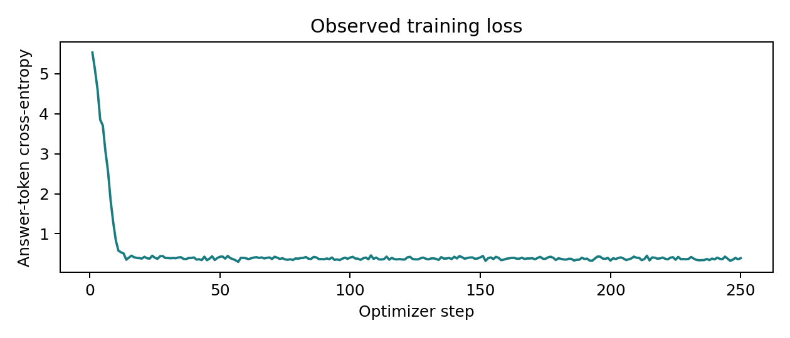

# Measured results

LoRA improves selection on the sampled testB split, while the testA gain is small and statistically inconclusive. Renumbering candidates frequently changes the selected object even when aggregate accuracy changes little. This compact model remains a research prototype.

All measurements come from saved predictions generated on a free Colab Tesla T4. They describe fixed, filtered subsets of RoboRefIt, **not the full official benchmark**. There is one expression per sampled image. Seed 42 is the prespecified primary model.

## Main comparison

| Split | Images | Random expectation | Pretrained | LoRA | Paired gain | Paired bootstrap 95% interval |
|---|---:|---:|---:|---:|---:|---|
| Validation | 128 | 20.0% | 25.0% (32/128) | 41.4% (53/128) | +16.4 pp | +7.8 to +25.8 pp |
| testA | 200 | 22.7% | 29.0% (58/200) | 31.0% (62/200) | +2.0 pp | -6.0 to +10.0 pp |
| testB | 200 | 20.5% | 17.5% (35/200) | 27.5% (55/200) | +10.0 pp | +2.5 to +17.0 pp |

All original-condition outputs were valid under the frozen parser. Random expectation averages `1 / n_candidates` over the examples. Paired intervals resample matched image pairs. They exclude uncertainty from training seeds, scene overlap, annotation errors and domain shift; no multiple-comparison correction is applied.

Validation participates in checkpoint selection and its gain is not an unbiased final estimate. Step 250 was selected over step 125 using validation accuracy only. The configuration and primary seed were frozen before test evaluation.

## Where does adaptation help?

The validation sample contains only shelf scenes, five candidates per image, and expressions that trigger the spatial-keyword proxy. This differs from the test distributions. The mismatch is a plausible contributor to the larger validation gain, but these measurements do not establish causality.

| Group | n | Pretrained | LoRA |
|---|---:|---:|---:|
| testA, spatial keyword present | 76 | 26.3% | 42.1% |
| testA, no spatial keyword | 124 | 30.6% | 24.2% |
| testA, repeated annotated class | 154 | 29.9% | 34.4% |
| testA, no repeated annotated class | 46 | 26.1% | 19.6% |
| testB, spatial keyword present | 50 | 28.0% | 36.0% |
| testB, no spatial keyword | 150 | 14.0% | 24.7% |
| testB, repeated annotated class | 132 | 19.7% | 27.3% |
| testB, no repeated annotated class | 68 | 13.2% | 27.9% |

These are descriptive strata, not independently tuned tasks. Spatial keywords and repeated classes are proxies, not verified semantic labels. Scene and candidate-count results, including small groups and regressions, are retained in [strata.csv](results/report/strata.csv). TestA table scenes decrease from 30.1% to 26.9% (n=93), while shelf scenes increase from 27.0% to 40.5% (n=37). The testA two-candidate group has only one image.

## Controlled robustness

| Split | Change | Accuracy | Same underlying object as original |
|---|---|---:|---:|
| testA | Instruction wrapper | 32.5% | 85.0% |
| testA | Candidate renumbering | 35.5% | 46.0% |
| testA | Brightness x0.8, contrast x0.9 | 32.0% | 82.0% |
| testB | Instruction wrapper | 27.0% | 84.0% |
| testB | Candidate renumbering | 26.0% | 39.0% |
| testB | Brightness x0.8, contrast x0.9 | 25.0% | 78.0% |

Renumbering changes the selected physical candidate in **54% of testA cases and 61% of testB cases**. Similar aggregate accuracy is insufficient to claim permutation invariance. Intervals in [robustness.json](results/report/robustness.json) include zero for all accuracy changes. Only one alternative numbering and one visual perturbation were tested per image. The wording test changes the wrapper, not the referring expression itself.

## Training-seed repeat

| Training seed | Selected step | testA | testB |
|---|---:|---:|---:|
| 42, primary | 250 | 31.0% | 27.5% |
| 43, repeat | 250 | 30.0% | 25.0% |

Data selection and evaluation numbering stay fixed at seed 42. Both adapted runs improve over the pretrained point estimate on testB; testA gains remain small. Two seeds do not characterize the distribution of training outcomes. Seed 43 never replaces the primary model. Complete metrics are in [seeds.json](results/report/seeds.json).

## Compute and verification

- 1,638,400 trainable language-attention LoRA parameters; original language and vision weights frozen.
- Rank 8, alpha 16, dropout 0.05, learning rate 0.0002, effective batch size 8, 250 optimizer steps over 2,000 images.
- Primary training: 604.1 seconds excluding validation and 2.96 GiB peak allocated GPU memory. Repeat: 599.6 seconds and 2.96 GiB.
- Mean inference latency: about 0.30 s pretrained and 0.34 s adapted. Batch size 1, greedy generation, one warmup, CUDA synchronization. Includes processing and generation; excludes image loading/rendering and the separately timed digit diagnostic.
- Each saved adapter reproduced all 128 validation outputs exactly after loading in another process.
- Answer-mask, finite nonzero LoRA-gradient and frozen-base checks passed. Loss includes template whitespace and end-of-turn tokens; falling loss alone is not grounding evidence.
- `scripts/verify_results.py` checked 2,656 released final predictions against manifest target mappings, parsing, metrics, checkpoint selection and reload evidence.

## Examples and reproduction

The [generated detailed report](results/report/RESULTS.md) retains deterministic fixes, regressions, shared failures and shared successes. For example, `testB:3034` ("could you find the light brown lion") changes from incorrect candidate 1 to correct candidate 3. `testB:492` ("I want to grasp the yellow glue stick") regresses from correct candidate 1 to candidate 4. Both remain in the evaluation.

The notebook generates a comparative image gallery. A separate private gallery export is also delivered. Source photos are omitted from the public repository because dataset-image redistribution terms were not established. Static plots, comparisons, manifests and prediction tables are readable without Colab.

Final measurements are in [results/experiment](results/experiment). Primary-training validation artifacts retain an obsolete first-token diagnostic; their free-generation scores remain valid. Use `final-baseline`, `final-adapted` and `final-repeat` for the corrected canonical-digit diagnostic and reported final measurements. See [the execution ledger](docs/VALIDATION.md) for notebook evidence and environment limitations.

Multi-permutation training and a more representative validation design are reasonable future experiments. They were not run or selected using these test results. Supplied candidates, annotation noise, filtered subsets and uncertain physical scene independence remain material limitations.
